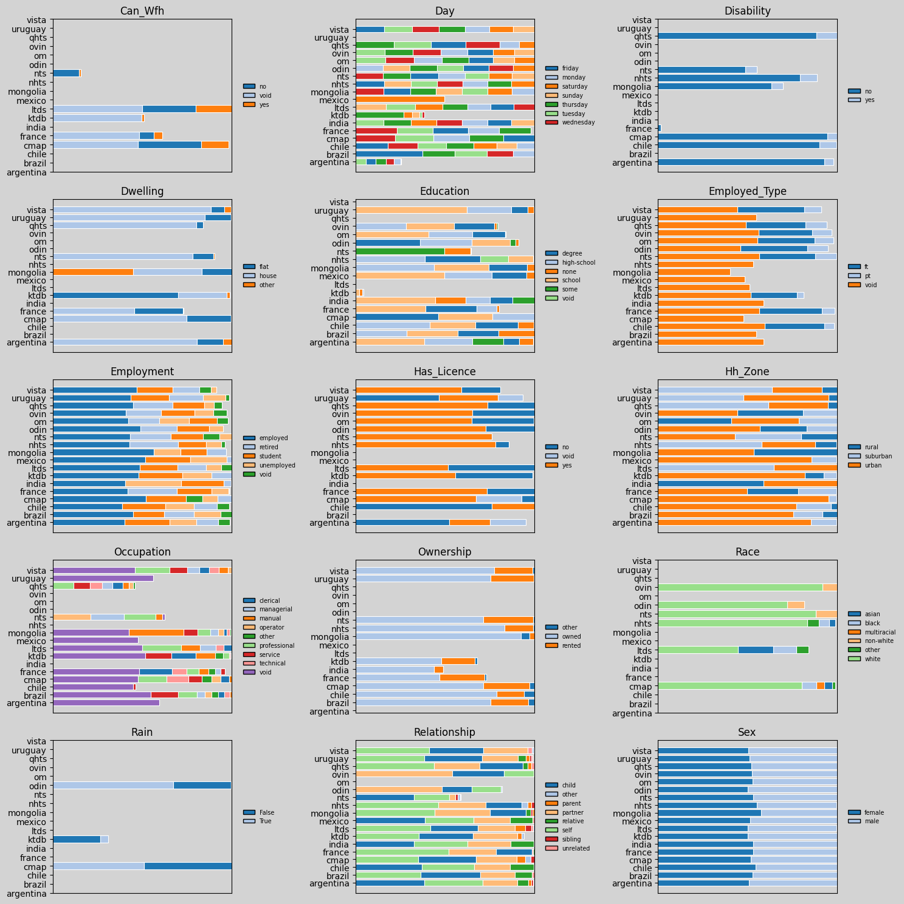
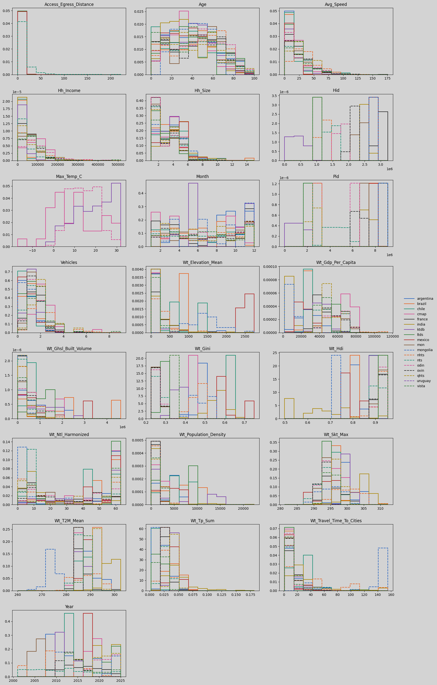
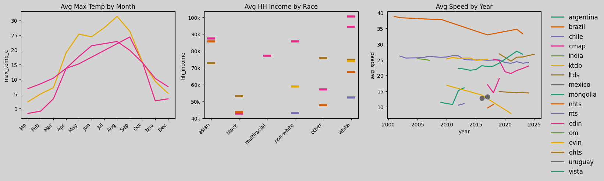
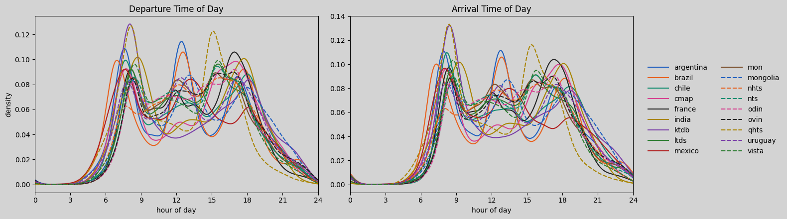
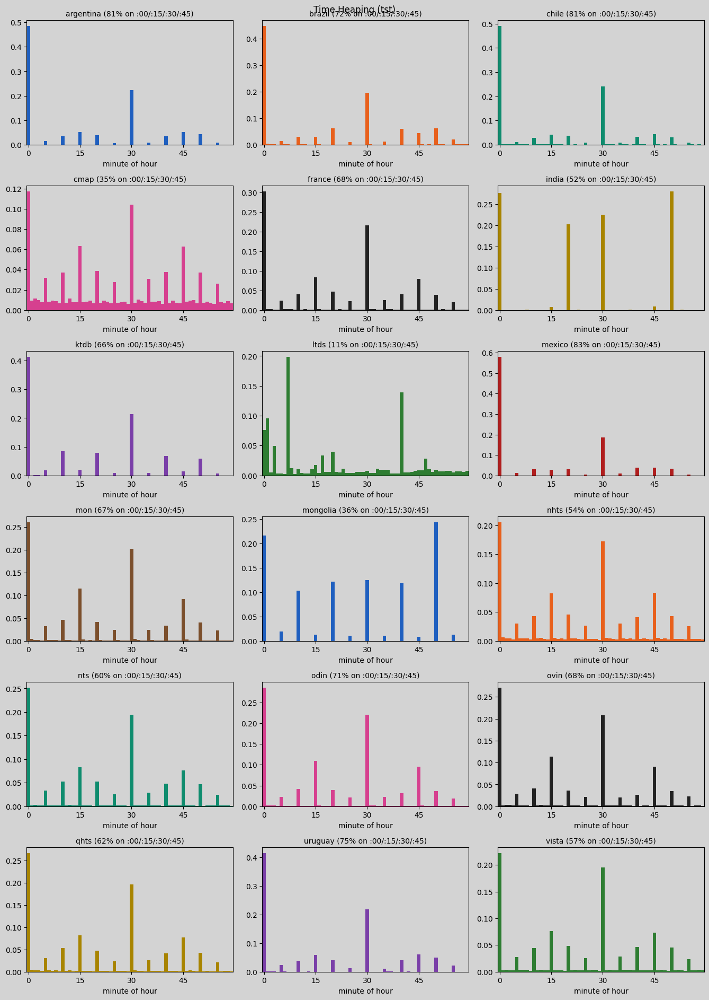
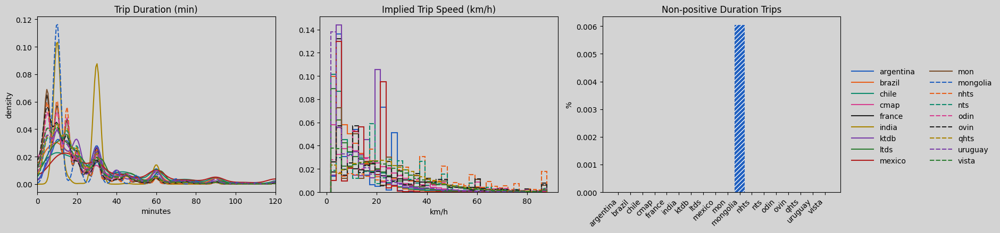
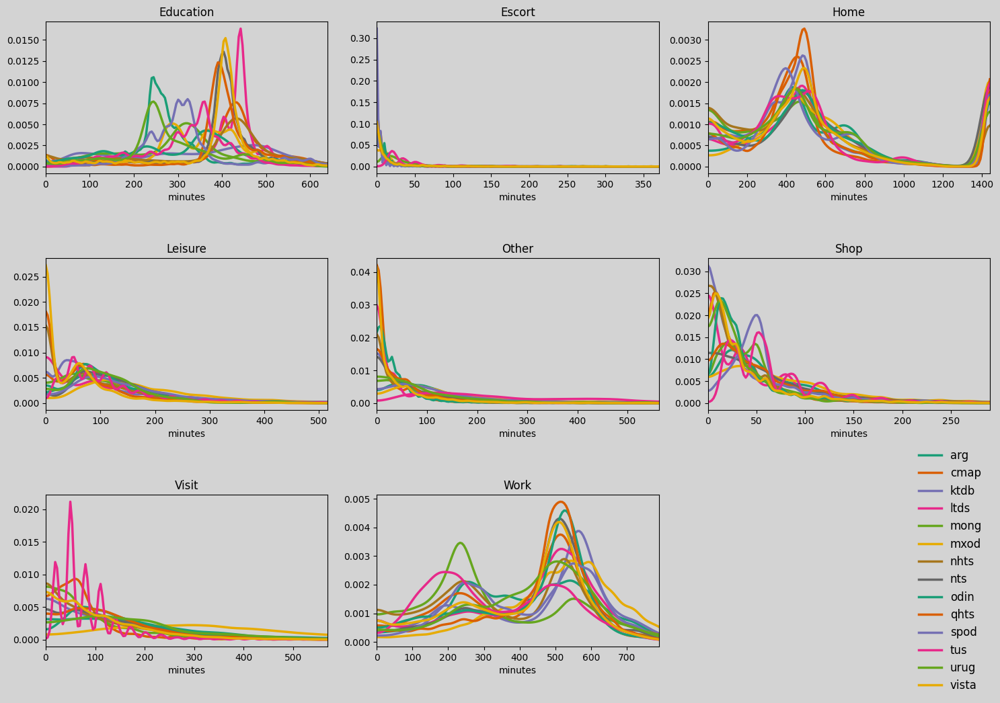
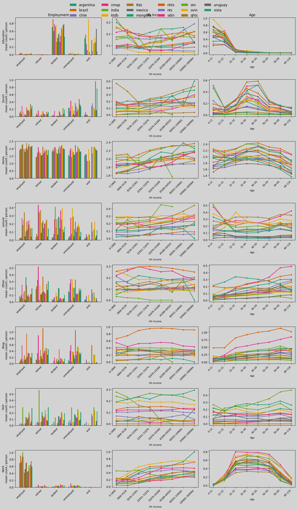

[](https://github.com/fredshone/foundata/actions/workflows/weekly.yml)

Foundata is a pipeline for creating reconciled household travel surveys, aimed at enabling *foundational* models of human behaviour — but also a useful source of code for those wishing to work with openly available datasets.

We also have a pre-processed dataset of one-million openly available persons and their plans [here](https://github.com/fredshone/foundata/tree/main/data/).

The project is intended to be uses as a discoverable cli via `uv run foundata --help`.

For example, `uv run foundata run --help`:
```
Usage: foundata run [OPTIONS]

  Run the data processing pipeline end-to-end.

Options:
  -d, --data-root PATH                                Base data directory, e.g. ~/Data/foundata [required]
  -o, --output PATH                                   Directory where CSVs and PNGs are written, defaults to ./output  [default: output]
  -s, --select TEXT                                   Comma-separated list of sources to process (e.g. --select nhts --select ktdb).
  -x, --omit TEXT                                     Comma-separated list of sources to omit (e.g. --omit nhts --omit ktdb).
  --open                                               Run only the open-data sources (nhts, cmap, vista, qhts, ktdb, mexico, argentina, uruguay, chile). Overrides --select and --omit.
  -hb, --home-based / -ab, --any-based                Whether to only include home-based trips (i.e. those with 'home' as the origin or destination activity).  [default: home-based]
  -fc, --filter-consecutive / -ac, --any-consecutive  Whether to filter out consecutive home, work and education activities. [default: filter-consecutive]
  --help                                              Show this message and exit.
```

The base data directory needs to hold raw data downloaded from the various sources by the user. The template directory `data_dir_template`, shows the expected folder and files structure.

### Data Summary

The latest output using `uv run foundata run` is as follows:

| Source    | Plans         | Missing attributes | Trips          | Trip kms (millions) |
|-----------|---------------|--------------------|----------------|---------------------|
| nts       | 2,483,044     | 20%                | 4,420,967      | 45.4                |
| ktdb      | 2,223,232     | 30%                | 4,344,040      | 36.2                |
| india     | 875,802       | 50%                | 1,903,711      | n/a                 |
| nhts      | 631,537       | 27%                | 2,203,880      | 24.9                |
| odin      | 383,679       | 26%                | 886,686        | 9.6                 |
| mexico    | 348,070       | 48%                | 494,949        | 5.3                 |
| ovin      | 290,618       | 33%                | 722,782        | 7.5                 |
| om        | 158,503       | 41%                | 421,213        | 4.1                 |
| vista     | 89,465        | 30%                | 235,847        | 2.0                 |
| argentina | 85,950        | 34%                | 133,105        | 0.9                 |
| brazil    | 83,895        | 33%                | 150,846        | 0.9                 |
| ltds      | 60,522        | 36%                | 108,337        | 0.9                 |
| chile     | 56,574        | 25%                | 104,749        | 0.8                 |
| qhts      | 48,718        | 33%                | 117,885        | 1.2                 |
| mongolia  | 46,100        | 34%                | 99,267         | n/a                 |
| cmap      | 25,716        | 7%                 | 76,658         | 0.5                 |
| uruguay   | 5,173         | 38%                | 10,753         | 0.1                 |
| **total** | **7,896,598** | **30%**            | **16,435,675** | **140.2**           |


\* Plans: a sequence of activities and associated trips within a 24hr period starting at midnight.

\*\* missing attributes: attribute data with `unknown`/`null` values.

### Data Sources

Foundata makes use of open (safely available, either immediately, or available via simple request) datasources as follows


|  Name             | Location  | ~Years    | Note              | Source             |
| ----------------- |---------- |-----------|-------------------|--------------------|
| ODIN        | NL | 2018-24 | household income deciles converted to gross | [Request](https://ssh.datastations.nl/dataset.xhtml?persistentId=doi:10.17026/SS/TR1TUW)     |
| OVIN        | NL | 2010-17 | ODiN's predecessor; respondents with foreign, truck or holiday trips are dropped, and professional travel (no trip detail) is kept only as time at work; disposable income bands converted to gross | [Request](https://ssh.datastations.nl/)     |
| OM          | NL | 2005-07 | MON, OViN's predecessor; whole households; household income summed from members' net income bands and converted to gross (null for ~24% of persons); no migration background or household position | [Request](https://ssh.datastations.nl/)     |
| KTDB        | KR |  2010,16,21  | National surveys, no weights. 2021 personal survey: mostly Thursdays, no income info for young people. 2016 household (mostly Thursdays) and weekend (Saturday and Sunday diaries) surveys. 2010 household (weekday, date unknown) and weekend (Sat/Sun) surveys with trip ends at 시군구 level only, so distances come from district centroids or duration x speed | Open [data](https://www.ktdb.go.kr/www/index.do) (stay on korean language site)     |
| NTS         | UK      | 2002-24     |                   | [Request](https://ukdataservice.ac.uk/)            |
| CMAP        | US      | 17-19     | Small but good attribute availability | Open [data](https://github.com/CMAP-REPOS/mydailytravel) |
| NHTS        | US      | 2001,09,17,22 |               | Open [data](https://nhts.ornl.gov/downloads) & [docs](https://nhts.ornl.gov/documentation) |
| QHTS        | AUS | 2012-24     |          | Open [data](https://www.data.qld.gov.au/dataset/queensland-household-travel-survey-series) |
| VISTA       | AUS | 2012-25  |             | Open [data](https://opendata.transport.vic.gov.au/dataset/victorian-integrated-survey-of-travel-and-activity-vista) |
| LTDS        | UK  | 2019-24  | Exact trip times and durations are sampled | Request from TfL (try to contact the LTDS team) |
| INDIA       | IN | 2019,24 | Time use survey so limited trip info | [data](https://microdata.gov.in/nada/index.php/catalog/236/related-materials)     |
| BRAZIL      | BR | 2017-18 | São Paulo metro region, weekdays only, ~56% of incomes imputed by the survey | Open [data](https://transparencia.metrosp.com.br/dataset/pesquisa-origem-e-destino/resource/4362eaa3-c0aa-410a-a32b-37355c091075) |
| MEXICO      | MX | 2017 | Mexico City metro region, weekday (Tue-Thu) and Saturday diaries, no income, distances estimated from stage durations | Open [data](https://www.inegi.org.mx/programas/eod/2017/#microdatos) |
| ARGENTINA   | AR | 2009-13 | Five household mobility surveys (Buenos Aires ENMODO, Salta, Santa Fe-Paraná, Neuquén-Cipolletti, Resistencia-Corrientes), weekdays only, distances estimated from stage durations, short personal trips lack times | Open [data](https://www.argentina.gob.ar/transporte/dgppse/publicaciones/encuestas) |
| URUGUAY     | UY | 2016 | Montevideo metro region, one weekday (Mon-Fri, day not recorded), no income, distances from blocks walked or census segment centroids | Open [data](https://montevideo.gub.uy/tipo/area-tematica/movilidad/observatorio-de-movilidad) |
| MONGOLIA    | MN | 2011,19,23 | Time use survey, so limited trip info: many trips implied by a change of place; 2-3 diary days per person in 2011/19; mode recorded only for travel in 2023 (else the person's or household's best mode) and 2011, never in 2019; no income or distance | [Request](https://nada.nso.mn/en/catalog/53/get-microdata) (free registration) |
| CHILE       | CL | 2012-13 | Santiago metro region (EOD 2012), all days of the week incl. summer season, ~68% of households have some member income imputed by the survey, distances from straight-line block or zone centroids | Open [data](https://github.com/PLUMAS-research/palomatrix-dtpm/tree/main/src/palomatrix/eod/datos) (SECTRA EOD 2012 as parquet) |


### In progress or todo

- Various FR [repo](https://github.com/MobiSurvStd/MobiSurvStd)     |
- Bogotá EM 2023 / 2019
- MTUS harmonised episodes (Korea) https://timeuse.org/
- Tokyo PT 2008 / 2018
- JICA PT surveys via PFLOW
- Hong Kong TCS 2011 / 2022

### Plans

We encode human activity plans as sequences of activities and associated trips. Foundata `run` will output both an activities table and a trips table. Temporal and spatial consistency is enforced, so that activity sequences should be physically plausible.

### Activities

The activities output combines activities with their **preceding** trip:

|   pid | seq | act     |   start |   end |
|------:|-----|:--------|--------:|------:|
|     0 | 0   | home    |       0 |   600 |
|     0 | 1   |  shop   |     600 |  660  |
|     0 | 2   |  home   |     660 |  1440 |

We currently map all activities to the following types: {home, work, education, visit, medical, leisure, shop, escort, other}. Note that not all sources use all of these types. Medical, for example, is not included in many datasets.

### Trips

The trips output provides both trip information and origin/destination location and activity information:

|   pid | seq | ozone | dzone | oact | dact | mode | tst | tet | distance |
|------:|:----|------:|------:|------|------|------|-----|-----|----------|
|     0 | 0   | rural | urban | home | shop | car  | 600 | 620 | 12       |
|     0 | 1   | urban | rural | shop | home | car  | 660 | 680 | 12       |

Trip start time (tst) and trip end time (tet) are in minutes since midnight. Distance is in km.

We currently map all transport modes to the following types: {car, walk, bike, bus, rail, other}.

### Person Attributes

Plans are joinable by a unique person id (pid) to attributes. Attributes include household, individual, day and plan information.

|   pid | source   |   year | age   | employment   | hh_income   | hh_zone   | ... |
|------:|:---------|-------:|:------|:-------------|:------------|:----------|-----|
|     0 | xxxx     |   2021 | 51-65 | employed     | ≤21280      | urban     | ... |

Categorical person attributes, **Blank** signifies missing or "unknown" data:



There has been a lot of effort to consolidate categories across the different data sources. You can see the mappings used in `/configs`. Note that (i) we allow unknown categories (null or unknown), and (ii) in some cases we allow "overlapping" categories.

Numeric person attributes:



A sample of some trends:



Data availability (non null or unknown) by source and attribute:

| Attribute              | argentina | brazil | chile | cmap | india | ktdb | ltds | mexico | mongolia | nhts | nts  | odin | om   | ovin | qhts | uruguay | vista | all  |
|------------------------|-----------|--------|-------|------|-------|------|------|--------|----------|------|------|------|------|------|------|---------|-------|------|
| country                | 100%      | 100%   | 100%  | 100% | 100%  | 100% | 100% | 100%   | 100%     | 100% | 100% | 100% | 100% | 100% | 100% | 100%    | 100%  | 100% |
| year                   | 100%      | 100%   | 100%  | 100% | 100%  | 100% | 100% | 100%   | 100%     | 100% | 100% | 100% | 100% | 100% | 100% | 100%    | 100%  | 100% |
| weight                 | 100%      | 100%   | 100%  | 100% | 100%  | 100% | 100% | 100%   | 100%     | 100% | 100% | 100% | 100% | 100% | 100% | 100%    | 100%  | 100% |
| sex                    | 100%      | 100%   | 100%  | 100% | 100%  | 100% | 100% | 100%   | 100%     | 100% | 100% | 100% | 100% | 100% | 100% | 100%    | 100%  | 100% |
| hh_zone                | 100%      | 100%   | 100%  | 100% | 100%  | 100% | 100% | 100%   | 100%     | 100% | 100% | 100% | 100% | 100% | 100% | 100%    | 100%  | 100% |
| age                    | 100%      | 100%   | 100%  | 100% | 100%  | 100% | 100% | 100%   | 100%     | 100% | 100% | 100% | 100% | 100% | 100% | 100%    | 100%  | 100% |
| hh_size                | 100%      | 100%   | 100%  | 100% | 100%  | 99%  | 100% | 100%   | 100%     | 100% | 100% | 100% | 100% | 100% | 100% | 100%    | 100%  | 100% |
| employment             | 100%      | 100%   | 99%   | 100% | 99%   | 100% | 100% | 100%   | 96%      | 96%  | 100% | 95%  | 98%  | 98%  | 96%  | 98%     | 90%   | 99%  |
| hh_income              | 99%       | 100%   | 100%  | 99%  | 100%  | 98%  | 45%  | 0%     | 0%       | 95%  | 92%  | 98%  | 75%  | 99%  | 39%  | 0%      | 96%   | 90%  |
| vehicles               | 100%      | 98%    | 100%  | 100% | 0%    | 100% | 100% | 100%   | 100%     | 100% | 100% | 100% | 100% | 100% | 100% | 100%    | 100%  | 89%  |
| relationship           | 100%      | 100%   | 100%  | 100% | 100%  | 95%  | 100% | 100%   | 100%     | 100% | 56%  | 84%  | 0%   | 100% | 100% | 99%     | 100%  | 82%  |
| employed_type          | 59%       | 53%    | 99%   | 45%  | 57%   | 82%  | 53%  | 49%    | 40%      | 50%  | 100% | 95%  | 98%  | 98%  | 96%  | 54%     | 90%   | 81%  |
| day                    | 26%       | 100%   | 100%  | 100% | 100%  | 39%  | 100% | 50%    | 100%     | 100% | 100% | 100% | 100% | 100% | 100% | 0%      | 100%  | 80%  |
| has_licence            | 95%       | 0%     | 100%  | 100% | 0%    | 99%  | 100% | 0%     | 0%       | 88%  | 80%  | 100% | 100% | 100% | 100% | 93%     | 82%   | 75%  |
| ownership              | 0%        | 100%   | 100%  | 100% | 50%   | 69%  | 0%   | 0%     | 100%     | 100% | 100% | 0%   | 0%   | 0%   | 0%   | 100%    | 100%  | 68%  |
| avg_speed              | 65%       | 70%    | 76%   | 78%  | 0%    | 82%  | 63%  | 64%    | 0%       | 81%  | 65%  | 78%  | 82%  | 79%  | 78%  | 73%     | 74%   | 65%  |
| month                  | 26%       | 100%   | 100%  | 100% | 0%    | 31%  | 0%   | 0%     | 100%     | 100% | 100% | 100% | 100% | 100% | 100% | 0%      | 100%  | 64%  |
| dwelling               | 100%      | 0%     | 0%    | 100% | 0%    | 99%  | 0%   | 0%     | 100%     | 0%   | 90%  | 0%   | 0%   | 0%   | 84%  | 100%    | 100%  | 60%  |
| education              | 99%       | 100%   | 100%  | 100% | 100%  | 4%   | 0%   | 100%   | 100%     | 100% | 67%  | 91%  | 83%  | 80%  | 0%   | 100%    | 0%    | 59%  |
| occupation             | 59%       | 100%   | 43%   | 100% | 0%    | 97%  | 100% | 48%    | 99%      | 0%   | 65%  | 0%   | 0%   | 0%   | 48%  | 56%     | 100%  | 55%  |
| race                   | 0%        | 0%     | 0%    | 99%  | 0%    | 0%   | 83%  | 0%     | 0%       | 99%  | 100% | 84%  | 0%   | 100% | 0%   | 0%      | 0%    | 48%  |
| access_egress_distance | 0%        | 29%    | 33%   | 0%   | 0%    | 6%   | 24%  | 29%    | 0%       | 0%   | 89%  | 0%   | 0%   | 0%   | 0%   | 27%     | 0%    | 32%  |
| disability             | 98%       | 0%     | 100%  | 100% | 0%    | 0%   | 0%   | 0%     | 69%      | 91%  | 58%  | 0%   | 0%   | 0%   | 100% | 0%      | 0%    | 29%  |
| can_wfh                | 0%        | 0%     | 0%    | 98%  | 0%    | 51%  | 100% | 0%     | 0%       | 0%   | 13%  | 0%   | 0%   | 0%   | 0%   | 0%      | 0%    | 20%  |
| max_temp_c             | 0%        | 0%     | 0%    | 100% | 0%    | 30%  | 0%   | 0%     | 0%       | 0%   | 0%   | 100% | 0%   | 0%   | 0%   | 0%      | 0%    | 14%  |
| rain                   | 0%        | 0%     | 0%    | 100% | 0%    | 30%  | 0%   | 0%     | 0%       | 0%   | 0%   | 100% | 0%   | 0%   | 0%   | 0%      | 0%    | 14%  |


## Usage

### Setup

```bash
uv sync          # install dependencies and register the CLI entry point
foundata --help
```

### Trying it out with toy data

`data_dir_template/` is a small, runnable stand-in for a real `~/Data/foundata/`
tree — same folder/file layout, just a handful of rows per source — so you can
try the pipeline without access to any of the real data:

```bash
foundata run --data-root data_dir_template --output /tmp/out
```

### Adding a new source

1. **Scaffold boilerplate** — generates empty YAML configs and a stub loader:
   ```bash
   python scripts/scaffold_source.py <source>
   ```

2. **Populate YAML configs** in `configs/<source>/`:
   - `hh_dictionary.yaml` — household column mappings and value remappings
   - `person_dictionary.yaml` — person column mappings and value remappings
   - `trip_dictionary.yaml` — trip column mappings and value remappings

3. **Validate YAML configs** against the template schema:
   ```bash
   foundata validate-config <source>
   ```
   Fix any reported ERRORs (value labels not in the template set). WARNs for
   intermediate fields are expected and can be ignored.

4. **Implement `load()`** in `foundata/<source>.py` following the pattern of
   existing loaders (e.g. `nhts.py`). The function should return
   `(attributes_df, trips_df)` normalised to the template schema.

5. **Run the loader, write CSVs, then validate output**:
   ```bash
   foundata validate-table attributes.csv trips.csv
   ```

6. **Add the source to `foundata/run.py`** so it is included in the full pipeline run (follow the existing `if "source" in sources:` pattern).

### Running specific sources

Use `--select` / `-s` to run only a subset of sources, or `--omit` / `-x` to exclude sources:

```bash
# Run KTDB only
foundata run --data-root ~/Data/foundata --select ktdb --output /tmp/out

# Run KTDB and NTS
foundata run --data-root ~/Data/foundata -s ktdb -s nts --output /tmp/out

# Run everything except NTS
foundata run --data-root ~/Data/foundata --omit nts --output /tmp/out
```

Available sources: `ltds`, `vista`, `qhts`, `cmap`, `nhts`, `nts`, `ktdb`, `odin`, `ovin`, `om`, `india`, `brazil`, `mexico`, `argentina`, `uruguay`, `mongolia`, `chile`.

### Binning numeric attributes

The `bin` command discretises numeric columns in an attributes CSV into labelled string bins, using the same quantile/uniform logic as the pipeline's `binned_attributes.csv` output — but runnable on any attributes file with full control over bin counts.

```bash
# All numeric columns binned into 5 quantile bins (default)
foundata bin attributes.csv

# Override the default bin count
foundata bin attributes.csv --default 8

# Per-column overrides: --COLUMN N takes precedence over --default
foundata bin attributes.csv --default 5 --age 10 --hh_income 3

# Uniform (equal-width) bins, explicit output path
foundata bin attributes.csv --default 5 --method uniform --output binned.csv
```

Options:

| Option | Short | Default | Description |
|--------|-------|---------|-------------|
| `--default N` | `-n` | `5` | Default number of bins for all numeric columns. |
| `--method` | `-m` | `quantile` | `quantile` (equal-frequency) or `uniform` (equal-width). |
| `--output PATH` | `-o` | `<input>_binned.csv` | Output CSV path. |
| `--select TEXT` | `-s` | | Columns to bin (repeatable, e.g. `--select age --select hh_income`). |
| `--omit TEXT` | `-x` | | Columns to exclude from binning (repeatable). |
| `--COLUMN N` | | | Per-column bin count override (e.g. `--age 10`). |

### Filling missing values

The `fill-unknown` command fills null/missing values in an attributes CSV with the string `"unknown"`, and reports the percentage of each column filled. It warns if a column is entirely unknown or looks numeric (filling a numeric column with a string is usually a mistake).

```bash
foundata fill-unknown attributes.csv --output filled.csv
```

Options:

| Option | Short | Default | Description |
|--------|-------|---------|-------------|
| `--output PATH` | `-o` | `<input>_filled.csv` | Output CSV path. |

### Filtering output CSVs

The `filter` command group applies post-processing filters to `attributes.csv` / `trips.csv` outputs.
All filter commands accept `-a`/`--attributes` (optional), `-t`/`--trips` (required), and output options `-o` (directory), `-oa` (explicit attributes path), `-ot` (explicit trips path).

```bash
foundata filter --help
```

| Command | Description |
|---------|-------------|
| `homebased` | Keep only plans whose first and last activity is home. |
| `missing-acts-or-modes` | Remove plans with null or `unknown` activities or modes. |
| `consecutive-activities` | Remove plans with consecutive same-type activities (e.g. work→work). Configurable via `-n`/`--non-consecutive-types` (default: `home`, `work`, `education`). |
| `negative-trips` | Remove plans containing trips where `tst > tet`. |
| `negative-activities` | Remove plans with overlapping trip times (negative activity durations). |
| `null-times` | Remove plans with null trip start or end times. |
| `time-consistent` | Apply all time-consistency filters in one step. |
| `attributes` | Filter persons on a column value and restrict trips to survivors. |

Example:

```bash
foundata filter consecutive-activities -t trips.csv -a attributes.csv -n work -n education -o output/
```

### Splitting into train/test sets

The `split` command creates train/test splits of one or more CSVs, keeping all records for each person entirely in one set (never split across both). Pass any number of CSV files — they must all share the same set of group IDs.

```bash
foundata split attributes.csv trips.csv activities.csv --split 20 --output /tmp/split/
```

Output:

```
Split on 'pid': 800 train / 200 test (20%)
  attributes.csv                 →     800 train /     200 test rows
  trips.csv                      →    6431 train /    1612 test rows
  activities.csv                 →    9204 train /    2301 test rows
Wrote outputs to /tmp/split/
```

Each input file produces `<stem>_train.csv` and `<stem>_test.csv` in the output directory.

Options:

| Option | Short | Default | Description |
|--------|-------|---------|-------------|
| `--group COL` | `-g` | `pid` | Column to group by. |
| `--split PCT` | `-s` | `20` | Test set size as a percentage. |
| `--output DIR` | `-o` | parent of first input | Output directory. |
| `--seed N` | | `42` | Random seed for reproducibility. |


### Diagnostics

Departure/arrival time-of-day density, wrapped onto a 0-24h axis. The legend shows each source's share of trips with a raw start/end time greater than 1440 minutes (an uncorrected day-wrap is a common symptom of a source-specific time bug):



Minute-within-hour "heaping" per source — self-reported times tend to round to :00/:15/:30/:45, and a source heaping much more than the others usually means less precise raw timestamps:



Trip duration, implied speed (`distance / duration`), and the share of trips with non-positive duration, per source:



Activity duration distributions, faceted by activity type:



Activity participations by employment, income and age:


