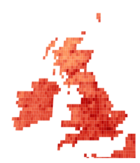
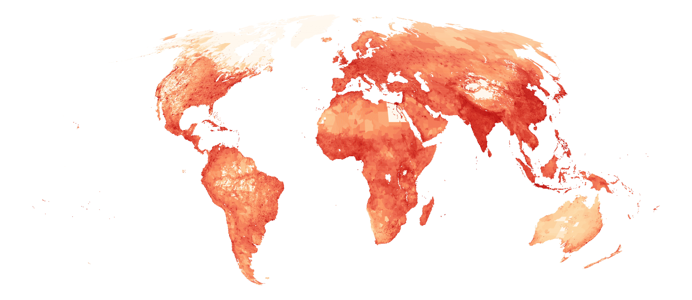

# Gridded data

To allow for a worldwide model we provide household location labels that are:

- globally available
- that are invariant from location to location
- likely to be correlated to human behaviors

We use [WorldTensor](https://zenodo.org/records/19047618) datasets. WorldTensor provides various variables on a 0.25° global grid. Both `run` and `batch` join these variables to the attributes table using hh_location.

```bash
uv run foundata batch ~/Data/foundata                 # WorldTensor from ~/Data/foundata/WORLD
uv run foundata batch ~/Data/foundata --world DIR     # another WorldTensor root
uv run foundata batch ~/Data/foundata --no-grid       # skip it: wt_ columns are null
```

## Precision

The 0.25° global grid call vary in size from zero a the poles to aroun 25km x 25km at the equator.

<figure>

<figcaption style="text-align: center">WorldTensor UK (log) population density </figcaption> 
</figure>


## Variables

| column | WorldTensor layer | available years | units |
|---|---|---|---|
| `wt_gdp_per_capita` | human_systems | 1990–2022 | GDP as USD per capita (PPP, constant 2021) |
| `wt_ghsl_built_volume` | human_systems | 1975–2020 | Building volume as m³ |
| `wt_gini` | human_systems | 1990–2023 | Gini index |
| `wt_hdi` | human_systems | 1990–2015 | Human development index |
| `wt_ntl_harmonized` | human_systems | 1992–2018 | Night-time lighting |
| `wt_population_density` | human_systems | 2000–2020 | Persons/km² |
| `wt_tp_sum` | climate (ERA5) | 1940–2025 | Total precipitation as m (see below) |
| `wt_t2m_mean` | climate (ERA5) | 1940–2025 | Mean temperature in K |
| `wt_skt_max` | climate (ERA5) | 1940–2025 | Max temperature K |
| `wt_elevation_mean` | static topography | static | Elevation above sea level in m |
| `wt_travel_time_to_cities` | static (Weiss et al. 2018) | 2015 | Travel time to nearest city (minutes) |

<figure>

<figcaption style="text-align: center"> WorldTensor (log) population density </figcaption> 
</figure>

## Years

Each variable is taken from its year on disk nearest the survey year,
the earlier of two equally near. Within a range with no gaps that is the
survey year itself; past the end of a range it is the last year, so a
2023 survey gets `hdi` from 2015 and `ntl_harmonized` from 2018. A
static layer has one year, its snapshot's where the file gives one
(`travel_time_to_cities` 2015), else null.

`wt_<var>_year` records the year used on every row, so you can see how
far each value is from its survey year (`year - wt_<var>_year`). The
`gridjoin` key of `locations.parquet`'s metadata has the same mapping,
per variable from each survey year to the year used, with its units and
source.

`wt_tp_sum` averages 0.029 m a year worldwide. It appears to be the sum
of 12 monthly means of daily totals, not an annual total (multiply by
about 30.4 to get one). The values are kept as the files give them.

To change the variables, edit `VARIABLES` in
`foundata/gridjoin/worldtensor.py` and the matching `wt_` entries in
`configs/core/template.yaml`; a test checks that the two agree.

## How a location gets a cell

Each location has a point (`lon`, `lat`) and a radius (`scale_m`). The
point is the polygon's point on surface, so it is always inside the
polygon. The location takes the cell its point is in, found by
arithmetic with no geometry library, and each distinct cell is looked
up once.

The grid is point-registered: there are 721 × 1440 cell centres at
latitudes -90…90 and longitudes 0…359.75, so cell edges sit halfway
between centres. The cell is:

- `row = floor((lat + 90.125) / 0.25)`, clipped to 0…720;
- `col = floor((lon + 0.125) / 0.25) mod 1440`.

A point exactly on an edge goes to the cell north or east of it.
Latitudes ±90 stay in the polar rows, and longitudes 180 and -180 are
the same column.

These columns are in `locations.parquet`:

- `wt_cell` is `row * 1440 + col`.
- `wt_spans_cells` is true when the location's bounding box crosses a
  cell edge, so the single cell is an approximation. That is 33% of
  polygons and under 1% of points. A point's box is the point ± its
  radius. A polygon split at the antimeridian, like Alaska, gets the
  narrow box across ±180°, not one spanning the globe.

A location whose cell is NaN in a layer (over the sea, or masked out,
which can differ by year) takes the nearest valid cell of that layer
whose centre is within 50 km of its point, else null. The `gridjoin`
metadata gives, per variable, how many home locations and years were on
a NaN cell (`on_nan_cells`) and how many the fallback filled (`filled`).

The fallback radius is 50 km, about two cells, because some masks are
eroded at coasts. For `gdp_per_capita`, the nearest valid cell is 35 km
from Nice and 43 km from Montevideo. With each layer's most recent year,
across the 183k locations from all sources, the fallback filled 7,763
locations for GDP and 7,285 for travel time, and at most 25 stayed null
for any one variable. The counts for a run are in its metadata.
