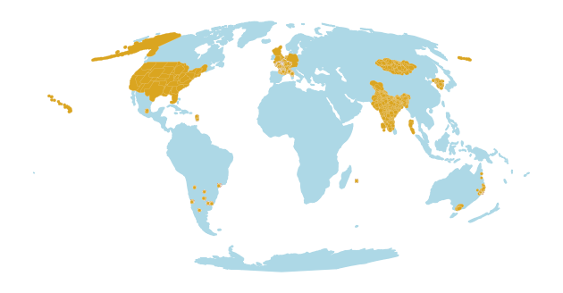

# Location data

Attribute data includes home location, and most trips carry their origin and destination:

- `hh_location` in attributes
- `ocode`/`dcode` in trips
- `location` in activity_schedules

<figure markdown="span">
{ style="display: block; margin: 0 auto; max-width: 100%;" }
<figcaption style="text-align: center">Locations </figcaption> 
</figure>

To minimise size, all locations are indexes, that refer to geoemtries defined by the output `locations.parquet` (see below), which gives the zone (or point), its precision, its polygon, centroid, its size and where the geometry came from.

| Column | |
|---|---|
| `location_id` | id in this output: each source's locations are numbered in `location_key` order, after the previous source's |
| `location_key` | stable across runs: `<source>/<geo>/<code>`, or `<source>/point/<lon>,<lat>`; loaders write these keys, and the runner swaps them for ids per source |
| `source`, `country`, `continent` | the survey source, its country and continent |
| `level`, `code` | the kind of unit (`gemeente`, `sa1`, `point`) and the unit's code |
| `geo` | the lookup the code is from (`gemeente_2018`), which fixes the code list's vintage |
| `precision` | coordinate, small area, large area or region (from the level) |
| `lon`, `lat` | a point inside the polygon, or the point |
| `scale_m` | radius of a circle with the polygon's area (before simplification), or the assumed uncertainty of a point; use it to pick a raster resolution or a sampling radius |
| `geom_source` | `point` (the survey's coordinate), `boundary` (the unit's own polygon), `parent` (the unit has no published polygon, so a unit known to contain it), `estimated` (**work in progress**: a provisional area containing the unit) or `none` (no geometry: the code is not in the boundaries, e.g. trips abroad) |
| `geom_dataset`, `geom_year` | the boundary dataset and its vintage (of the survey, for point data) |
| `geometry` | the point, or the unit's polygon simplified to 5% of its equivalent radius (5 m to 1 km); polygons are simplified one at a time, so neighbours can gap or overlap by up to that much |

Conventions:

- Codes are standard codes where the survey allows (ONS, FIPS, ABS, CBS, INDEC, KOSTAT/MOIS, NSO), mapped from survey numbering in the source's loader. Survey-specific zone systems keep the survey's codes, prefixed where they would clash (French detailed zones are `<survey>/<zone>`).
- Where codes are renumbered or redrawn between rounds, each round reads the lookup of its year (`gemeente_2012`, `cbsa_2013`, `dong_2016`, `radio_2010`), so the same code in two vintages is two locations.
- Each source declares its locations in `home_location` (`hh_dictionary.yaml`) and `trip_location` (`trip_dictionary.yaml`, for both trip ends): per survey year, the levels finest first, each with its lookup file, e.g. ODIN 2018: `pc4` (`pc4.parquet`), then `gemeente` (`gemeente_2018.parquet`). The source's loader builds the codes (padding, mapping, validity), and a household or trip end takes the first level whose code is in its lookup, so a code the boundaries don't have falls back to the next level (NHTS: CBSA or MSA, else state; France: detailed zone, else point, else commune; Argentine radio to fracción, Korean 행정동 to 시군구, Mongolian bag to soum). See `foundata/location.py`.

Coverage is the share of households in the full batch with a geometry (any `geom_source` other than `none`); exact is the share whose unit has its own boundary, or is a point. Median `scale_m` is over households. Trip ends is the share of trip origins and destinations with a geometry. `foundata location-summary <batch output>` prints these numbers:

| Source | Home levels | Coverage | Exact | Median `scale_m` | Trip ends with geometry |
|---|---|---|---|---|---|
| argentina | fraccion, radio | 100% | 100% | 213 m | — |
| brazil | point | 100% | 100% | 50 m | 100% |
| chile | point | 100% | 100% | 50 m | 98.2% |
| cmap | tract | 100% | 100% | 875 m | 99.8% |
| france | commune, detailed_zone, point | 100% | 97.3% | 715 m | 99.5% |
| india | district | 100% | 100% | 35.0 km | — |
| ktdb | dong, sigungu | 100% | 100% | 969 m | 100% |
| ltds | lad | 100% | 100% | 3.7 km | 96.9% |
| mexico | eod_district | 100% | 0.5% | 6.0 km | 96% |
| mongolia | bagh, soum | 99.7% | 27.4% | 19.8 km | — |
| nhts | cbsa, census_division, msa, state | 99.6% | 99.6% | 167.8 km | — |
| nts | region | 100% | 100% | 70.6 km | — |
| odin | gemeente, pc4 | 99.7% | 99.7% | 1.3 km | 98.1% |
| mon | gemeente | 100% | 100% | 5.1 km | 99.8% |
| ovin | gemeente | 100% | 100% | 5.3 km | 97.4% |
| qhts | sa1 | 100% | 100% | 256 m | 99.8% |
| uruguay | segment | 100% | 100% | 320 m | 99.6% |
| vista | lga | 100% | 100% | 6.0 km | 99.8% |

Notes:

- Brazil and Chile give dwelling coordinates without a stated precision, so 50 m is an assumption. 99.9% and 99.8% of them fall in their own survey zone.
- Mexico and Mongolia are **work in progress**. Mexico's EOD 2017 districts were never published as polygons, and they cut across municipalities, so each district takes the union of the municipalities it overlaps; only Tizayuca (a whole municipality) is exact. Mongolian bag boundaries are not public outside Ulaanbaatar, so a rural bagh takes its soum, and Ulaanbaatar khoroos have been split since 2019, so 2019 khoroos take today's khoroo of that number. These `estimated` geometries contain the unit, so `scale_m` is an honest radius of uncertainty, but they are much larger than the unit itself. Possible sources: the district map in UNAM's EOD 2017 report (Mexico), OpenStreetMap or the NSO (Mongolia).
- French zones without a polygon (all of Calvados 2011, and a few zones in seven other surveys) take their draw zone, else their commune (`parent`). French trip ends without a geometry are mostly abroad (INSEE codes 99xxx).
- Lookups cover the survey area, sometimes a bit more (CMAP: three states; VISTA: Victoria; LTDS: the UK). Trip ends outside them have `geom_source` none.

Lookups are GeoParquet files in `configs/<source>/geo/`, named by the `geo` entries of the declarations (`code, lon, lat, area_km2, geom_source, geom_dataset, geom_year, geometry`; about 38 MB in all). Each file's parquet metadata (key `foundata`) records the datasets (URL, sha256), the method, alias files, and codes matched fuzzily or not at all. `scripts/build_location_lookups.py` builds them all, for the files each source declares, downloading the public boundary files it needs to `<data root>/boundaries/` (its docstring lists them) and recording each in `configs/location_datasets.lock.csv`. `scripts/build_location_lookup.py` builds one from a local boundary file. Trip distances use the same lookups (KTDB, Chile and Uruguay zone points).